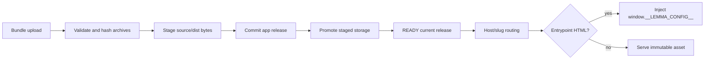

# Apps module

## Purpose

`app/modules/apps` hosts pod-specific operator applications. It owns app
metadata, versioned source/dist releases, bundle validation and storage,
authenticated pod asset access, public slug routing, browser SDK delivery,
runtime configuration injection into HTML entrypoints, and the reserved assets
that let a published app be installed to a home screen.

## Runtime contributions

| Contribution | Behavior |
| --- | --- |
| Pod API router | App CRUD, widget-to-app creation, bundle upload, assets, source/dist archive download |
| Public app router | Resolve an app by host/slug and serve its built assets |
| Public SDK router | Serve `lemma-client.js`, legacy alias, and `lemma-ui.js` |
| Middleware | `AppHostRoutingMiddleware` maps app subdomains/hosts to public app routes |

There are no event consumers or worker tasks in this module. Builds performed
during pod-bundle import use the sandbox runtime from the bundle module.

## Data and storage

| Table/storage | Meaning |
| --- | --- |
| `apps` | Pod/name, public slug, metadata, readiness/current release |
| `app_releases` | Immutable source/dist object keys, hashes, sizes, and release state |
| `resource_permission_grants` (grantee `APP`) | The app's declared grants: what its page may do for its viewer |
| Object storage/local store | Source and distribution zip archives plus extracted assets |

## API groups

| Routes | What they do |
| --- | --- |
| `/pods/{pod_id}/apps` | Create/list/read/update/delete app records |
| `/.../apps/from-widget` | Promote a conversation widget into an app definition |
| `/.../apps/{name}/bundle` | Upload source and/or built distribution archives and finalize a release |
| `/.../apps/{name}/permissions` | Read or replace the app's declared grants (also inline `permissions` on create/update) |
| `/.../assets...` | Serve an authenticated pod app asset |
| `/.../source/archive`, `/.../dist/archive` | Download stored release archives |
| `/public/apps...` | Host-based public app entrypoint/assets |
| `/apps/access/tickets` | One-minute ticket for the app host named by `Origin` (not in OpenAPI) |
| `/_lemma/app-access/redeem` | Trade a ticket for the app host's access cookie (not in OpenAPI) |
| `/.lemma/...` | Manifest, icons, service worker, offline page and cover (on the app host) |
| `/public/sdk/*` | Browser SDK and web-component bundles |

## Release and serve flow

Storage uses a stage/commit/promote pattern with cleanup compensation. HTML
lint is advisory and reports obsolete SDK usage; it does not reject app code.
Entrypoints are no-cache and receive pod/API/auth context at serve time, while
hashed static assets use immutable caching and ETags.
An app that is not public is served on its hosted HTTPS address only to a
holder of that host's `__Host-lemmaAppAccess` cookie; anyone else, and any
absent slug, gets the same sign-in page. The page trades the API session for a
signed one-minute ticket bound to the requesting origin, then redeems it on the
app host for a signed 12-hour cookie (`services/app_access.py`; no server-side
records). Each read rechecks the session, the account and `app.read` --
`app.update` too on a release preview -- at most every
`app_access_cache_ttl_seconds`, through Redis. Private responses, here and on the
authenticated asset route, are `private, no-cache` with ETags, so a 304 follows
only an allowed check. The cookie never authenticates an API operation.
`AppsSettings` owns source/dist/combined upload ceilings and archive-entry,
expanded-size, and compression-ratio protections.

## Home-screen install

An app is served on an origin of its own, which is what lets it carry a web app
manifest and be installed like any other application. `app.core.app_install`
owns the reserved `/.lemma/` paths and the offer script injected into public
entrypoints; `services/app_install_assets` answers those paths, and
`services/app_icon` draws the icon from the app's name and slug, since apps
carry no uploaded one.

The reserved assets are resolved ahead of the release lookup because none of
them describe a build, so a rebuild leaves an installed icon alone. They are
served through the ordinary public asset route, so the PUBLIC visibility gate
covers them: an unpublished app does not describe itself in a manifest. The
service worker exists only to satisfy the browser's installability check and
caches nothing but the offline page — caching app assets would pin a stale
release onto whoever installed it. It answers navigations from their preload,
not by re-fetching `event.request`: a re-fetched navigation arrives with
`Sec-Fetch-Dest: empty`, and a private app's host decides between its sign-in
page and a bare 401 by whether the request loads a page. The host also accepts
`Sec-Fetch-Mode: navigate` for that, so workers installed before the preload
still reach the sign-in page.

The offer never interrupts a first visit. The workspace marks its
"open in a tab" links with `#install` so the app's builder is asked at the
moment they asked for a tab; everyone else is asked on a second visit. Inside
the workspace's app frame the pill still appears, but installing is a top-level
operation, so it asks the workspace to open the app itself
(`lemma-app-install-request`).

## Cover

Every public entrypoint's Open Graph and Twitter image is the app's own
`/.lemma/cover.png`, 1200×630: what a shared link unfurls with, and what the
workspace's app cards show. Unlike the install assets it is not claimed
outright. A build that ships `.lemma/cover.png` is served that file, and only
when it does not does `services/app_cover` draw one from the app's name,
description and slug — the icon's letter and colour at cover size. Either way
the address is fixed while the picture changes with each release and rename, so
the cover takes the entrypoint's revalidating cache policy, with an ETag over
the release and what the drawing shows.

The host never photographs a running app. A cover leaves Lemma for good, and
any one person's view would show others rows they may not open, so an app's own
cover is rendered by the agent that builds it, from invented sample rows,
through `lemma-skills/lemma-app-design/scripts/cover_serve.py`, which gives the
page a localhost API and no credentials (`references/cover.md` in that skill).

## Authorization and security

Pod management/download routes use the normal pod context. Path normalization
and archive extraction prevent asset traversal. Apps remain arbitrary
user-authored HTML/JS, so isolation by origin and response headers is part of
the security boundary.

**An app is its own principal (audit H20).** App hosts are same-site with the
API and an app's page calls it with the viewer's session cookie, so that call
used to *be* the viewer -- their full authority and every account they had
connected. `core/authorization/app_principal.py` now reads the app from the
host the browser says the request came from: `Origin` when the page calls the
API's host, `Host` when it calls through its own `/_lemma` door. A script
cannot set either; the `__Host-` access cookie never reaches the API host, and
`X-Lemma-App` is the app's own word, so neither is used. The request becomes
`Workload(APP, app_id, for_user_id=viewer)`:

- **Authority** is the viewer's access intersected with the app's grants, on
  the same path a named agent takes -- the ladder, the SQL projections and
  listings, the pod pin. A viewer outside the pod of a Public app keeps the
  Public reads the app was granted.
- **Routes**: pod routes, plus `APP_ROUTES` outside a pod (who is viewing,
  the connector catalogue) in `core/api/actor_policy.py`. Account, org and
  every other route answer `WORKLOAD_NOT_ALLOWED`. The ticket route is the
  host's door (`APP_HOST_DOORS`), answered as the person. On the live socket
  an app watches the `records` topic only, each table decided with its grants;
  the other topics and calls decide as the viewer and refuse it.
- **Refusal**: outside its grants an app gets `403 APP_NOT_GRANTED` with
  `details.resource_type`, `resource_name` and `permission_ids`. No session
  approval and no fallback to the viewer. The TS SDK throws it as
  `AppNotGrantedError` and posts it (`lemma-app-not-granted`) to the page
  framing the app; the web app says it over the app and offers an editor
  "Add this grant", which opens the app's Grants panel with it prefilled.
- **Grants** (`services/app_grants.py`) are ordinary grant rows with grantee
  `APP`. Setting them is conferral: the setter must be able to do each on that
  resource (`CONFERRAL_EXCEEDS_HOLDER`). Uploading a bundle or promoting a
  release confers them again -- the publisher must hold every grant the app
  has, since their code runs behind it. They are deleted with the app. A
  check asked of the pod itself (listing its tables, talking to its agents) is
  met by a grant on the pod, named `pod`, which carries only read and use
  capabilities (`POD_GRANTABLE_PERMISSIONS` in `core/authorization/grants.py`).
- **Existing apps** got, in migration 0063, reads of their pod's POD and
  PUBLIC tables and top-level folders and files, and nothing else: nothing in
  the database records what an app called (see the migration's section).
- The API host serves an app's files under `/pods/{pod_id}/apps/{name}/assets`
  with `Content-Security-Policy: sandbox`, so they never run as the API's own
  origin, where same-origin reads carry no `Origin`.

## Tests and operations

Tests cover lifecycle, host routing, public serving, storage compensation,
archive handling, HTML/SDK injection, CORS, and release deduplication.
