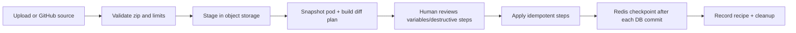

# Pod bundle module

## Purpose

`app/modules/pod_bundle` exports a pod as a portable bundle, plans the diff for
an uploaded/GitHub bundle, applies an approved plan step by step, and publishes
a bundle to GitHub through a connected account. Format primitives are shared
with the CLI through the top-level `lemma-pod-bundle` package.

## Runtime contributions

| Contribution | Behavior |
| --- | --- |
| API routers | Import/upload/plan/apply/replan/cancel/events, export/status/download, publish/status/events |
| Work items | `pod_bundle.{export,plan,import_github,import_url,apply,publish}`: admin class, pod namespace, one per pod at a time, written with the job's state row in the request's transaction |
| Periodic work | `pod_bundle.staging_sweep` (30 min): sweep expired staging objects, end jobs nothing will run again, delete job rows past retention |
| Realtime | Redis pub/sub SSE plus polling snapshots |
| SQL tables | `pod_bundle_jobs`, `pod_bundle_job_steps` |

Job state is authoritative in PostgreSQL and mirrored to Redis, not the other
way round: a Redis flush loses the realtime mirror, not the job. Every job
writes one `pod_bundle_jobs` row and one `pod_bundle_job_steps` row per plan
step, so the two tables grow with every export, import and publish — the sweep
deletes rows whose `completed_at` is past retention (30 days, the
`JOB_ROW_RETENTION_SECONDS` constant in `infrastructure/job_retention.py`), and
steps go with their job through the FK cascade. Zip archives are staged in
object storage. Completed import provenance is appended to `PodConfig.recipes`.

A worker that dies mid-job loses its lease and the next one resumes from the
first pending step (apply) or file (publish); a stopping worker hands the job
back at the next step boundary, uncharged. Cancel stays cooperative for a
running job and ends a queued one in its own transaction. An item that goes
dead (attempts, lease losses, the 30-minute cap) ends its job FAILED, or
CANCELLED if it was cancelling, in the dead transaction.

## Job state

| Job | Typical states |
| --- | --- |
| Export | `QUEUED -> EXPORTING -> READY` or `FAILED`; ready state includes signed download URL |
| Import | `QUEUED/FETCHING -> PLANNING -> AWAITING_CONFIRMATION -> APPLYING -> COMPLETED` or `FAILED/CANCELLED`; `PARTIALLY_CANCELLED` when steps had already been applied |
| Publish | `QUEUED -> EXPORTING/UPLOADING -> COMPLETED` or `FAILED` |

## API groups

| Routes | What they do |
| --- | --- |
| `/pods/{pod_id}/bundle/uploads` | Stage a local zip and mint a signed Lemma URL |
| `/.../bundle/imports` | Start URL/GitHub planning, poll, replan, approve apply, cancel, or stream SSE |
| `/.../bundle/exports` | Start/poll an export; authenticated signed-token download is `/pods/bundle/download` |
| `/.../bundle/publishes` | Start/poll/stream GitHub publication |

## Import flow

Every non-app apply step opens its own authorization/UoW scope and commits
before the Redis `DONE` checkpoint. App steps self-scope around a sandbox
build. A crash between commit and checkpoint replays an idempotent upsert. The
format handles pod connectors, tables/data, files, functions,
agents/grants/toolsets, workflows, schedules, apps/source, surfaces, and pod
metadata.

**Pod connectors** (`connectors/<slug>/<slug>.json`) carry the catalog
connector, mode, `required` and `purpose` -- never the installation or the
account a SHARED one runs as, which the exporter refuses to write. The plan
(`infrastructure/connector_planning.py`, over the connectors module's
`contracts/bundles.py`) maps each to the importing org's installations (default
first), says whether the importer may install Lemma's app for a missing one, and
lists the importer's own accounts a SHARED one could share; it never shares one
by default. `ApplyImportRequest.connectors` makes those choices, and
`domain/connector_plan.resolve_connector_choices` checks them before anything is
queued: no installation (`NEEDS_INSTALLATION`, unless creating one was chosen)
or a slug the pod already uses for another connector (`CONFLICT`) refuses the
apply with 422; a SHARED connector with no account imports `NEEDS_ACCOUNT`
with a warning. CONNECTOR steps run first, so every schedule, surface and grant
naming a slug finds it declared.

**Grants** travel in the manifest of whatever holds them -- an agent, a
function, or an app (`permissions.grants`, by resource name). A grant on the pod
itself is `resource_type: pod`, `resource_name: pod`, the one name every pod
answers to. Each holder's grants are a deferred `*_GRANTS` step, after every
resource they could name exists. An app's grants are conferral: the plan
(`infrastructure/grant_planning.py`) asks the conferral bound, as the importer,
about every grant whose resource already exists, and keeps what fails on its
`APP_GRANTS` step (`detail.refused`) and in the plan's warnings; applying such a
plan is refused `403 CONFERRAL_EXCEEDS_HOLDER` with the pod untouched. The step
itself sets them through the apps module's `replace_app_grants`, which asks
again of everything.

## Security and limits

Archive extraction is zip-slip and zip-bomb guarded. Import requires pod update;
export/publish require pod read plus account ownership where applicable.
Destructive table changes require explicit confirmation. Configurable per-item,
record, data, app, archive, and uncompressed-byte caps bound work, and a Redis
daily limiter bounds starts. Download URLs are purpose-signed and require a
logged-in user in addition to the token.

## Tests and operations

Unit/e2e tests cover format/diff, staging, limits, plan/apply idempotency,
variables, executable imported resources, apps, surfaces, GitHub import/publish,
SSE, expiry, and cleanup.
